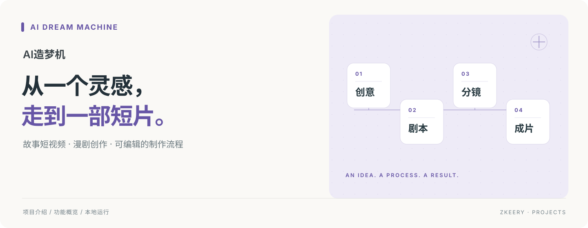

<!-- r03-context-calibration-v14:start -->
本地RAG原问题校准v14（2026-10-26，未接生产）：[R03精确人评关联、2475项回归与52条回放](docs/evidence/local-free-acceptance-20261025/rag-r03-calibration-v14-20261026/README.md) · [30条语境/版本控制](docs/evidence/local-free-acceptance-20261025/rag-r03-calibration-v14-20261026/context30-report.md)。仅R03原版本关联本轮人工接受，全部旧机器输出/目的提示与评分保留，H05不改；不放宽通用目的规则。Mock真实模型调用0、新增模型费用0。
<!-- r03-context-calibration-v14:end -->

<!-- implicit-relations-v13:start -->
本地RAG隐含表达v13（2026-10-26，未接生产）：[R03/H02、2404项回归与52条回放](docs/evidence/local-free-acceptance-20261025/rag-implicit-relations-v13-20261026/README.md) · [32条工程正反例单列](docs/evidence/local-free-acceptance-20261025/rag-implicit-relations-v13-20261026/engineering32-report.md)。H02只获效应关系有限支持；R03动作有据、目的仍待确认，整条未判定。原人评和历史保留，H05不改。Mock真实模型调用0、新增模型费用0。
<!-- implicit-relations-v13:end -->

<!-- condition-rule-v12:start -->
本地RAG有限规则v12（2026-10-26，未接生产）：[J05/J07/J10、2071项回归与52条回放](docs/evidence/local-free-acceptance-20261025/rag-condition-rule-v12-20261026/README.md) · [36条工程正反例单列](docs/evidence/local-free-acceptance-20261025/rag-condition-rule-v12-20261026/engineering36-report.md)。三条原正例获得有限文本支持，整条未判定；原52条状态/风险、原评分和历史答复不改，H05及H06/R11边界保留。Mock真实模型调用0、新增模型费用0。
<!-- condition-rule-v12:end -->

<!-- policy-status-v11:start -->
本地RAG状态表达v11（2026-10-26，未接生产）：[H06局部依据、1719项回归与52条回放](docs/evidence/local-free-acceptance-20261025/rag-policy-status-v11-20261026/README.md) · [22条工程正反例单列](docs/evidence/local-free-acceptance-20261025/rag-policy-status-v11-20261026/engineering22-report.md)。拒答理由有局部文本依据与整条回答未判定明确分开；H06/R11新增局部说明，52条旧状态/风险与评分不改，H05保留。Mock真实模型调用0、新增模型费用0，历史正文不覆盖。
<!-- policy-status-v11:end -->

<!-- batch-reference-calibration-v10:start -->
本地RAG检查器v10（2026-10-26，未部署）：[工程校准、1415项回归与52条回放](docs/evidence/local-free-acceptance-20261025/rag-batch-reference-calibration-v10-20261026/README.md) · [新8条单列报告](docs/evidence/local-free-acceptance-20261025/rag-batch-reference-calibration-v10-20261026/new8-report.md)。原52条状态与风险标记不变，H05保留；新8为4有限支持/4待复核，旧BND06获有限支持。原评分/历史不改，Mock真实模型调用0、新增模型费用0。
<!-- batch-reference-calibration-v10:end -->

<!-- boundary-calibration-v9:start -->
本地RAG检查器 v9（2026-10-26，未部署）：[校准、1030项回归与52条回放报告](docs/evidence/local-free-acceptance-20261025/rag-boundary-calibration-v9-20261026/README.md)。原52条状态与风险标记不变，H05保留；BND06继续机器复核。原评分和历史答复不改，Mock真实模型调用0、新增费用0。
<!-- boundary-calibration-v9:end -->

# AI造梦机

## 本轮封版：免费 Mock 演示

已将离线内容检查接到剧本和分镜生成、保存修改与历史版本恢复。页面直接显示问题位置、需核对的表述和修改建议，保留检查历史；提示仅供复核，不代表人工验收通过。已有三条人工判断只按原材料和版本关联，未重新评分，详见[封版记录](docs/release-20261026/README.md)。

在项目根目录运行 `backend/.venv/bin/python backend/scripts/serve_mock_demo.py`，另一个终端运行 `cd frontend && npm run build && npm run start -- --hostname 127.0.0.1`。打开 http://127.0.0.1:3030 ，演示邀请码为 `DEM23456`。演示脚本强制 Mock、屏蔽项目密钥并阻断后端外网，使用独立的 `.runtime/release-demo/data`，不改现有数据。

输入“内容检查演示”可生成一条带无依据安全保证的本地固定示例；输入“恢复演示”会在本次服务进程中模拟一次中断，随后可点击“继续上次生成”。这些是人工设计的流程示例，不是真实模型效果。[2 分钟演示路线](docs/release-20261026/demo-route.md)。

## 后续计划

普通事实覆盖、日期与复杂指代、独立留出及多人 RAG 校准，以及真实模型调用、云端复验和生产部署，本轮全部暂缓。

2026-10-25本地校准v8：12条合成材料36项明确人评单独保留，仅补三类范围外推NEED_REVIEW提示。661项回归通过，旧52条状态/风险标记及原证据不变，H05保留；新12条另表回放，J01/J04继续复核，未检查不等于合格。此前221文件保全，未接生产或部署；保持Mock，项目真实模型调用及新增模型费用0。见[v8交付与复跑](docs/evidence/local-free-acceptance-20261025/rag-calibration-v8/README.md)。下段v7为此前轮次记录。

2026-10-25本地专项：R07/H01/R10九项新增人工复核已完成，三条原版均可接受。v7新增独立的精确版本人工处置，不泛化放行隐含因果或世界范围外推；最终345项回归通过（原274项保留），52条机器结果与原证据全等，仍4条NEED_REVIEW，其中3条已关联人工接受，H05继续保留。原人工评分未覆盖，187旧文件保全；保持Mock，项目真实模型调用及新增模型费用0。详见[v7校准与回放](docs/evidence/local-free-acceptance-20261025/rag-human-calibration-v7/README.md)。原版真人双评已按指定来源确认，视频专项问题与候选复验分别保留，整体进度见[本地免费验收跟进](docs/evidence/local-free-acceptance-20261025/README.md)。

> 第三批本地内测（2026-10-11）：默认开启 `MODE_MOCK=1`、`DISABLE_OUTBOUND_NETWORK=1`、`SKIP_PROJECT_ENV=1`。当前不读取项目 `.env`，不调用真实模型；邀请码配额、同意门槛、埋点、假门与问卷已接入。74项独立门槛通过，但完整漫剧离线链两次在角色定妆阶段进入待对账，尚未验收完成，按循环限制停止。E1等待服务器，F1/F2未执行。见[技术开发文档](docs/阶段文档/第三批E2-E6-离线内测技术开发文档.md)。不要把旧真实请求验收指令当成本轮授权。

内测数据工具：`backend/scripts/create_trial_invites.py`（尚未执行；9个凭证写私有文件，不回显），`backend/scripts/export_trial_events.py --event <事件> --output <文件.csv>`，`backend/scripts/cleanup_trial_originals.py`。只在指定的独立 `DATA_DIR` 使用，禁止清零或覆盖已有费用账本。

**把一个故事想法，逐步做成可以预览、修改和下载的视频。**

面向短视频与漫剧创作者的本地 AI 创作工作台。把剧本、角色、分镜、画面和成片放在同一个流程里，每一步都可以先检查，再继续。

[快速开始](#快速开始) · [使用说明](docs/使用与运维说明.md) · [更多文档](docs/README.md)

## 为什么做

- **用户**：做故事短视频、漫剧的个人创作者。
- **痛点**：用即梦、可灵这类工具从头做完一部短片后发现，最难的不是生不出画面，而是改一句台词、换一个角色，整部片子都得跟着返工。
- **产品判断**：不拼单镜头画质，而是把一部作品当成一个整体来管。剧本、角色、分镜、画面、成片分阶段推进，每一步创作者确认后再往下走；哪里不对，只重做受影响的那部分。
- **需求与方案**：完整 PRD、多 Agent 协作说明和评测记录都在 [docs/](docs/README.md)。

## 创作工作台


*创作首页界面。背景与灵感卡为展示素材，生成作品在「我的作品」中查看。*

## 可以做什么

- **故事短视频**：从创意开始，生成剧本、角色场景、分镜、参考图、视频片段并合成成片。
- **漫剧创作**：制作漫画镜头图，添加对白、配音、基础运镜与中文字幕。
- **快捷工具**：文艺短视频、角色动作短片与图片配音口播。
- **资料与作品管理**：绑定创作知识库，修改内容、切换版本、复用素材；符合恢复条件的中断任务可以继续。

## 怎样完成一部作品

1. 选择故事或漫剧，写下创意，设置比例、模型与参考资料。
2. 检查剧本、角色和分镜，按需编辑或局部重新生成。
3. 确认画面后生成视频，或为漫剧生成配音并合成。
4. 预览和下载成片；回到「我的作品」继续修改。

## 快速开始

准备 Python 3.12、Node.js 24、FFmpeg / ffprobe。以下命令适用于 macOS / Linux：

```bash
git clone https://github.com/Zkeery/ai-dream-machine.git
cd ai-dream-machine
cp .env.example .env
python3.12 -m venv backend/.venv
backend/.venv/bin/pip install -r backend/requirements.txt
npm --prefix frontend install
(cd backend && .venv/bin/python scripts/manage_invite_codes.py generate -n 1)
bash start.sh
```

在 `.env` 填入自己的 `AIHUBMIX_API_KEY` 后启动。打开[本地创作台](http://127.0.0.1:3030)，使用命令生成的邀请码登录。后端端口为 `8030`；按 `Ctrl+C` 停止服务。

真实生成会调用付费模型；界面浏览和离线测试不等于真实生成。知识库首次使用会下载检索模型；漫剧配音需要联网，Linux 需配置中文字体 `COMIC_FONT_PATH`。

## 当前范围

这是本地 MVP，采用 Next.js + FastAPI，数据保存在 SQLite、本地媒体目录与 Qdrant。后端按单 worker 运行。漫剧目前以单集、基础运镜为主；角色一致性与成片质量仍需人工检查，嘴型同步的真实样片效果待验收。模型费用展示为估算，具体以供应商账单为准。

## 文档与代码

[使用与恢复](docs/使用与运维说明.md) · [配置示例](.env.example) · [文档导航](docs/README.md)

前端在 `frontend/`，后端在 `backend/`；需求、技术方案与历史验证记录统一放在 `docs/`。
